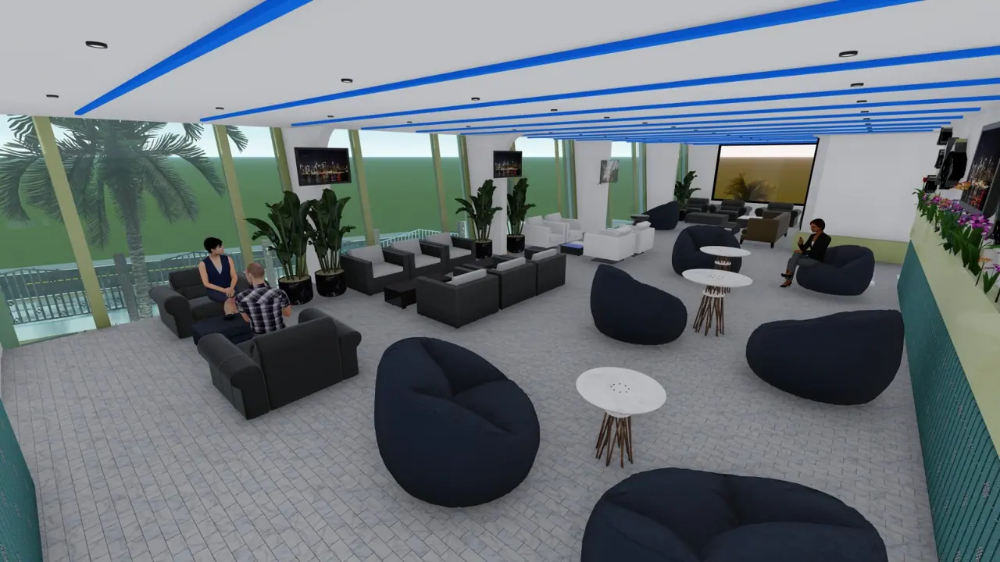
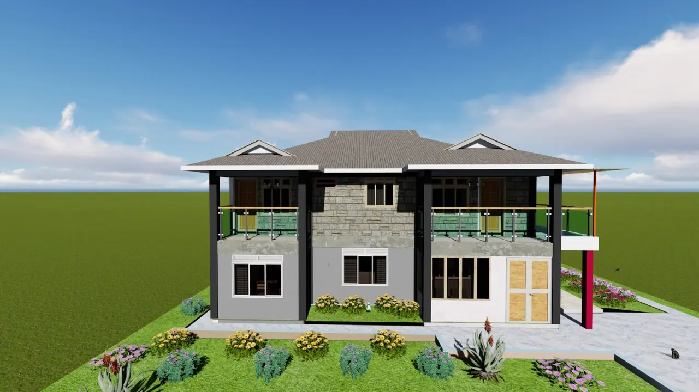
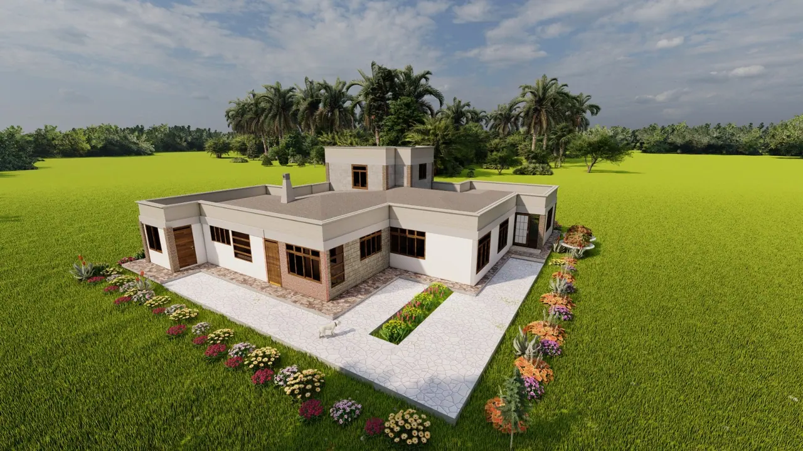
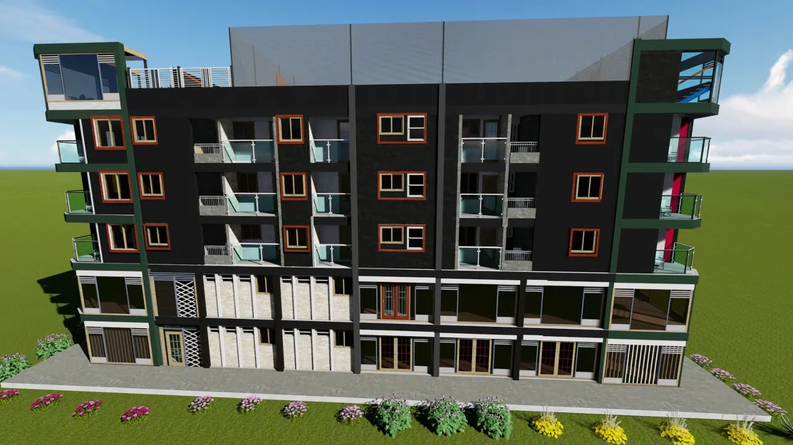
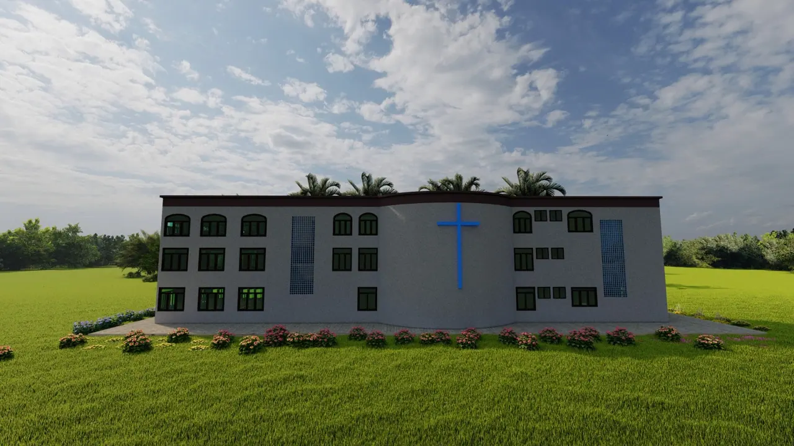

# ARKYLS — Architecture & Design (v3)

> Architecture & design studio, Nairobi. A marketing site with live 3D massing models, and a **Visual Portfolio** of 139 architectural visualisations across 11 design studies.

<p>
  
  
</p>
<p>
  
  
  
</p>

## Visual Portfolio

Open `/portfolio` to browse the studio's work: *Spaces, drawn in full.* Eleven studies, from a glass-atrium hotel and urban mixed-use blocks to hillside villas, stone cottages, garden pavilions, a chapel and the interiors inside them. Each study has a short write-up, a cover view and a keyboard-friendly lightbox.

| Study | Type | Views |
| --- | --- | --- |
| The Atrium Hotel | Hospitality | 26 |
| Urban Blocks | Mixed-use | 15 |
| Courtyard Apartments | Residential | 10 |
| Hillside Villa | Residential | 10 |
| Contemporary Family Residence | Residential | 7 |
| Courtyard Villa | Residential | 8 |
| Country Homes & Cottages | Residential | 19 |
| Garden Pavilions | Residential | 7 |
| Chapel & Gathering Hall | Institutional | 7 |
| Living Spaces | Interiors | 13 |
| Kitchens, Bedrooms & Baths | Interiors | 17 |

All images are 3D visualisations, not photographs of completed buildings. To add or reorder views, edit `src/data/portfolio.ts` and drop `<slug>-NN-640.webp` / `<slug>-NN-1280.webp` into `public/images/`.


React 19 + TypeScript + Vite 8 + Tailwind CSS 4. Migrated from the static HTML/CSS/JS + PHP v2 site.

## Quick start

```bash
npm install
npm run dev          # http://localhost:5173
npm run build        # type-check + production build → dist/
npm run preview      # serve the production build
npm test             # vitest (schema, API client, form, routing)
npm run lint
```

### Contact form backend (PHP + MySQL — unchanged stack, hardened)

```bash
mysql < api/schema.sql                 # creates `messages` (adds an `ip` column for rate-limiting)
php -S localhost:8080 -t .             # run from repo root; Vite proxies /api → :8080
```

Credentials come from env vars (`ARKYLS_DB_HOST/NAME/USER/PASS`, `ARKYLS_ALLOWED_ORIGINS`) — see `api/config.php`.
In production, deploy `dist/` and the `api/` folder to the same host (Apache `.htaccess` is in `public/`).
To use another backend, set `VITE_CONTACT_ENDPOINT`.

## Structure

```
src/
  pages/            Route components (code-split via router lazy()); Portfolio.tsx = Visual Portfolio
  components/
    layout/         Header, Footer, Layout, Intro (welcome), PageTransition (louvre curtain + message)
    three/          React Three Fiber: Building (parametric), Models (A-frame, villa), scenes, Canvas3D, Scene (WebGL guard)
    ui/             Button, Section, Photo (srcset), Slider (Embla), Lightbox (<dialog>), Seo, Icons
    effects/        Reveal, LineReveal, CountUp
    features/       ProjectIndex, ProjectTile, ServiceRow, ContactForm, CtaBanner, Poster
  data/             Typed content (site, projects, portfolio, services, about) + transitions.ts (page-change messages)
  lib/              contact schema + API client, image helpers, webgl check, intro flag
api/                PHP endpoint + SQL schema
```

## v3.1 — design direction

- **Look:** ink + bone-paper bands, one terracotta accent, hairline rules, numbered sections, mono technical captions, square corners. Tokens live in `src/styles/index.css` (`.theme-dark` / `.theme-light`).
- **3D (procedural, no model files):** hero building explodes into floor plates on scroll; Projects "Model studio" (mid-rise / A-frame / courtyard villa, sun angle, exploded view); Services construction sequence (site → massing → structure → complete) driven by scroll. Loaded lazily; falls back to a static poster without WebGL or on error. Pauses when off-screen; honours reduced-motion.
- **Welcome:** "Welcome to ARKYLS" once per browser session (click / Esc / Skip). Change copy in `components/layout/Intro.tsx`.
- **Page transition:** panels close, a per-page message shows, panels open. Edit messages in `src/data/transitions.ts`.
- **Tests:** `npm test` includes headless 3D tests (explode, construction stages) via @react-three/test-renderer.

## Content to review before launch

- Team: Emma Roberts removed; George Ngugi is Web Developer with a real photo. Lenny's bio is from the supplied text (the EARTGALLA sentence was left out). Edit in `src/data/about.ts`
- Project cards: image/name mismatches carried over (e.g. "Luxury Hotel", "Shopping Mall" use residential renders)
- "12 years experience" vs. "Founded 2023"; "98% client satisfaction", "100% / on-time guarantee" claims (the latter softened)
- Kiserian page publishes client name and budget — confirm consent
- Placeholder address "123 Design Avenue", `#` social links
